  

# 📱 Awesome Mobile E-Learning Storyboarding

  
  
  
  
  
  
  

---

## 🎯 Overview & Scope

A curated directory of premier **SaaS platforms** and **open-source GitHub projects** dedicated to **Mobile E-Learning Storyboarding**, touch-optimized sketching, infinite canvas curriculum mapping, and animatic pre-production.

Whether you are an **instructional designer**, **educational technologist**, **multimedia developer**, or **content creator**, these tools streamline the transition from raw pedagogy into visual course architectures, microlearning modules, and interactive video storyboards across tablets, stylus interfaces, and mobile screens.

---

## 📑 Table of Contents

- [📊 Sector Overview & Market Dynamics](#-sector-overview--market-dynamics)
- [☁️ SaaS & Hosted Platforms](#️-saas--hosted-platforms)
- [💻 Open-Source GitHub Projects](#-open-source-github-projects)
- [🛠️ Workflow Selection Matrix](#️-workflow-selection-matrix)
- [🤝 How to Contribute](#-how-to-contribute)
- [⚠️ Disclaimer](#️-disclaimer)
- [⭐ Star History](#-star-history)
- [💖 Support & Sponsorship](#-support--sponsorship)

---

## 📊 Sector Overview & Market Dynamics

> **Estimated Market Size**: The global digital visual collaboration and instructional design authoring software market is estimated at **$3.8 Billion in 2026** (embedded within the wider **$380+ Billion** global E-Learning ecosystem), expanding at a compound annual growth rate (**CAGR of ~16.4%**) fueled by mobile microlearning, bite-sized instructional video generation, and tablet-first touch workflows.

> **Market Fragmentation & Dynamics**: The space exhibits a **barbell concentration pattern**:
> - **Horizontal Whiteboard Giants**: Major visual workspace leaders (*Canva, Miro, Mural*) command widespread enterprise adoption through winner-take-most collaborative network effects.
> - **Specialized Niche Fragmentation**: Panel-based instructional design, dedicated video shot sequencing, SCORM animatic synchronizers, and offline tablet stylus sketching remain **highly fragmented** across specialized SaaS vendors (*Boords, Storyboard That, Padlet*) and a rapidly growing landscape of local-first, self-hosted open-source canvas engines (*Excalidraw, tldraw, AppFlowy, Storyboarder*).

---

## ☁️ SaaS & Hosted Platforms

The table below presents leading hosted solutions, sorted in descending order by **Company Scale (Valuation / Revenue)**:

| 🏷️ Platform | 🏢 Company Scale (Valuation / ARR) | 💵 Starting Pricing | 🎁 Free Tier / Trial Limits | 🎯 Target Workflow & Best For |
| :--- | :--- | :--- | :--- | :--- |
| [**Canva Whiteboards**](https://www.canva.com/) | **~$26B–$40B Valuation** *(~$2.3B+ ARR)* | **$12.99 / user / month** *(or $120.00 / year)* | **Free Forever**: • 5 GB cloud storage • 1M+ free stock graphics & photos • 250,000+ templates • Unlimited whiteboard collaboration | **Rapid Lesson Wireframing**: Best for educators wanting ready-made pedagogical presentation templates, drag-and-drop course decks, and cross-platform tablet sketching. |
| [**Miro**](https://miro.com/) | **~$17.5B Valuation** *(~$500M+ ARR)* | **$8.00 / user / month** *(billed annually at $96/yr, or $10/mo monthly)* | **Free Forever**: • 3 active editable boards • Unlimited team members • Pre-built community templates • Core Miro AI credits pool | **Enterprise Curriculum Architecture**: Best for multi-instructor teams mapping complex learning pathways, flowchart branchings, and macro course journeys on infinite canvases. |
| [**Lucidspark**](https://lucidspark.com/) | **~$3.0B Valuation** *(~$200M+ ARR)* | **$7.95 / user / month** *(billed annually, or $9.95/mo monthly)* | **Free Forever**: • 3 editable boards • Capped at 60 objects per board • Basic voting & standard sharing | **Structured Visual Brainstorming**: Best for instructional designers wanting tightly integrated diagramming, learning objective grouping, and LMS flowchart alignment. |
| [**Mural**](https://www.mural.co/) | **~$2.0B Valuation** *(~$100M+ ARR)* | **$9.99 / user / month** *(billed annually, or $12.00/mo monthly)* | **Free Forever**: • 3 active murals • Unlimited team members • Infinite canvas with guided facilitation • 1-click visitor view/comment | **Interactive Classroom Sprints**: Best for live virtual design sprints, interactive scenario workshops, and collaborative educator-student storyboard ideation. |
| [**Padlet**](https://padlet.com/) | **~$500M Valuation** *(~$40M+ ARR)* | **$6.99 / month** *(Platinum Individual billed annually at $83.88/yr, or $9.99/mo monthly)* | **Free Forever (Neon)**: • 3 active padlets (boards or sandboxes) • 20 MB max file upload limit • 2-min video & 5-min audio recording per post • Unlimited collaborator viewing | **Microlearning & Tablet Curation**: Best for quick classroom storyboarding exercises, visual card layouts, and touch-friendly mobile pinning without drawing steep learning curves. |
| [**Milanote**](https://milanote.com/) | **~$100M Valuation** *(~$15M+ ARR)* | **$9.99 / user / month** *(billed annually at $119.88/yr, or $12.50/mo monthly)* | **Free Forever**: • 100 total cards (notes, images, or links) • 10 file uploads total • Unlimited shared boards | **Tactile Course Moodboarding**: Best for creative instructional storytellers organizing multimedia lesson plans, concept art, and scene sequences on iPad/Apple Pencil. |
| [**Storyboard That**](https://www.storyboardthat.com/) | **~$50M Valuation** *(~$10M+ ARR)* | **$7.99 / month** *(Individual billed annually at $95.88/yr, or $11.99/mo monthly)* | **Free Forever**: • 2 storyboards per week • 3-cell layout maximum • Public storyboard visibility only • Watermarked image exports | **Comic-Style Scenario Training**: Best for K-12 and corporate compliance creators building character-driven dialogue scenarios, workplace roleplays, and comic sequences. |
| [**Boords**](https://boords.com/) | **~$20M Valuation** *(~$4M+ ARR)* | **$26.00 / month** *(Solo plan billed annually at $312/yr, or $39/mo monthly)* | **Free Forever (Try Boords)**: • 5 active storyboards • 3 active scripts • Up to 5 users • 8 sample AI image credits • Watermarked exports | **Video & Animatic Pre-Production**: Best for instructional video directors needing dedicated shot-by-shot panels, voiceover audio track sync, camera cue annotations, and client PDF sign-offs. |

---

## 💻 Open-Source GitHub Projects

The following active open-source projects power self-hosted, touch-friendly, or offline-first visual planning and storyboarding, sorted in descending order by **GitHub Stars_Count**:

### 1. [Excalidraw](https://github.com/excalidraw/excalidraw) 
- 🎨 **Distinctive Aesthetic**: Virtual whiteboard featuring a distinctive hand-drawn sketch style that keeps early course ideation approachable and informal.
- 📱 **Touch & Stylus Ready**: Highly optimized for iPad, Android tablets, and stylus devices with smooth palm rejection and intuitive gesture navigation.
- 🔒 **Local & Embeddable**: Zero-login local storage persistence, client-side end-to-end encryption, and a modular React component library (`@excalidraw/excalidraw`) to embed canvases directly into custom learning management systems.
- 🚀 **Best For**: Rapid thumbnail sketching, course flow diagrams, and interactive scenario wireframing.

### 2. [AppFlowy](https://github.com/AppFlowy-IO/AppFlowy) 
- 📋 **All-in-One Local Workspace**: Privacy-first, open-source alternative to Notion with native Flutter apps across iOS, Android, macOS, Linux, and Windows.
- 🗂️ **Multi-View Course Management**: Seamlessly connects visual storyboards, Kanban cards, document scripts, and structured database tables in a single unified project workspace.
- 📴 **100% Offline Capable**: All instructional assets and notes remain locally stored on your machine or private cloud instance.
- 🚀 **Best For**: Comprehensive instructional design management—from narrative lesson drafting and learning objectives tracking to modular storyboard cards.

### 3. [AFFiNE](https://github.com/toeverything/AFFiNE) 
- 🔄 **True Dual-Surface Canvas**: Instantly toggles between a clean linear text editor (scripting & learning objectives) and an infinite whiteboard (visual storyboards & concept mind maps).
- 🤝 **Local-First Real-Time Sync**: Powered by CRDTs (Conflict-free Replicated Data Types) for effortless multiplayer collaboration and offline resilience.
- 🐳 **Self-Hostable**: Easily deployable via Docker for educational institutions and enterprise teams with strict data sovereignty mandates.
- 🚀 **Best For**: Unified lesson development combining linear lecture scripts with expansive visual storyboards.

### 4. [Draw.io Desktop](https://github.com/jgraph/drawio-desktop) 
- 📐 **Industry-Standard Diagramming**: Desktop Electron application providing complete offline diagramming without network telemetry or registration.
- 🧩 **Comprehensive Shape Libraries**: Massive collections of flowcharting nodes, wireframe stencils, user journey arrows, and storyboard cell templates.
- 💾 **Universal File Interoperability**: Saves directly as open XML, SVG with embedded diagram data, or high-resolution PDF course assets.
- 🚀 **Best For**: Technical instructional workflows, branching scenario decision trees, and SCORM navigation logic maps.

### 5. [tldraw](https://github.com/tldraw/tldraw) 
- ⚡ **Ultra-Responsive Canvas Engine**: High-performance, lightweight infinite canvas designed with mobile browsers, touch events, and digital pens as first-class citizens.
- 🛠️ **Developer-Centric SDK**: The industry's premier open-source whiteboard library, powering custom storyboarding apps, interactive quizzes, and collaborative web tools.
- 🎯 **Minimalist UX**: Clutter-free interface leaving maximum screen real estate for visual lesson sketching.
- 🚀 **Best For**: Teams developing custom web-based e-learning storyboard authoring tools and mobile whiteboards.

### 6. [Xournal++](https://github.com/xournalpp/xournalpp) 
- ✍️ **Pressure-Sensitive Handwriting**: Native C++ handwriting and sketch suite supporting pressure-sensitive styluses (Wacom, Apple Pencil, Microsoft Surface Pen).
- 📄 **PDF Storyboard Annotation**: Import pre-printed storyboard grid PDFs, annotate frames with digital ink, and layer dialogue and camera directions.
- 🔊 **Audio Recording Alignment**: Synchronize spoken audio lecture scratch tracks alongside handwritten storyboard frames.
- 🚀 **Best For**: Tablet-first educators and instructional illustrators annotating multi-page storyboard templates.

### 7. [Drawnix](https://github.com/plait-board/drawnix) 
- 🧠 **Hybrid Visual Canvas**: Combines freehand drawing, structured mind mapping, and flowcharts on an infinite zoomable surface.
- 🤖 **Syntax-to-Visual Generation**: Generates mind maps from Markdown outlines and structured flowcharts from Mermaid syntax automatically.
- 🐳 **Docker-Deployable**: Clean self-hosted deployment architecture for private institutional servers.
- 🚀 **Best For**: Educational technologists turning text lesson outlines directly into visual board maps and freehand annotations.

### 8. [Rnote](https://github.com/flxzt/rnote) 
- 🖊️ **Vector-Native Tablet Ink**: Built in Rust and GTK4, tailored specifically for digital drawing tablets and touchscreens.
- 📐 **Adaptive Page Formats**: Switch between infinite canvas mode, fixed storyboard page grids, and continuous vertical scroll.
- 🪄 **Shape Recognition & Pressure Curves**: Smooths freehand curves, detects geometric shapes, and outputs scalable vector SVG storyboards.
- 🚀 **Best For**: Linux/Windows tablet creators seeking a lightweight, lag-free digital ink sketchpad for course thumbnails.

### 9. [OpenToonz](https://github.com/opentoonz/opentoonz) 
- 🎬 **Studio-Grade 2D Production**: The open-source animation production suite utilized by Studio Ghibli, equipped with full x-sheet exposure and camera track sequencing.
- 🎞️ **Animatics & Audio Sync**: Assemble storyboard stills along a visual timeline, sync scratch dialogue audio, and export timecoded animatic reels.
- 📐 **Vector/Raster Hybrid Engine**: Handles both hand-drawn bitmap storyboard panels and resolution-independent vector art.
- 🚀 **Best For**: High-end animated instructional courses and multimedia video e-learning productions.

### 10. [Storyboarder](https://github.com/wonderunit/storyboarder) 
- ⚡ **Rapid Panel Visualization**: Built specifically to make it easy to visualize stories as fast as you can draw stick figures.
- ✏️ **Dedicated Pre-Visualization**: Instant panel addition, dialogue and timing capture, shot reordering, and direct animatic export to Premiere/Final Cut/PDF.
- 🖨️ **Paper Worksheet Ingestion**: Print standard paper storyboard worksheets, sketch offline with a pencil, take a photo with your mobile phone, and Storyboarder will automatically align and ingest panels digitally.
- 🚀 **Best For**: Filmmakers, instructional video directors, and course animators needing dedicated shot-by-shot sequencing on desktop.

### 11. [OpenBoard](https://github.com/OpenBoard-org/OpenBoard) 
- 🏫 **Pedagogical Focus**: Purpose-built interactive whiteboard application designed specifically for schools, universities, and online classrooms.
- 📽️ **Podcast/Screencast Recording**: Record synchronized screen drawings and microphone audio straight into course-ready video lectures.
- 🖐️ **Interactive Screen Widgets**: Embed interactive web widgets, calculators, and media documents directly into presentation slides.
- 🚀 **Best For**: Teachers and online course lecturers needing a classroom-tested visual presentation and recording board.

### 12. [Tahoma2D](https://github.com/tahoma2d/tahoma2d) 
- 📽️ **Streamlined 2D Animation**: Community fork of OpenToonz engineered for easier learning curves, cleaner UI, and native stop-motion camera capture.
- ⏱️ **Timing & Scene Assembly**: Pre-visualize shot pacing and camera pans before committing to full module production.
- 🚀 **Best For**: Indie e-learning creators producing 2D educational explainer videos and animated course demos.

### 13. [Dim0](https://github.com/vcmf/dim0) 
- 🤖 **AI-Native Infinite Canvas**: Open-source, self-hostable collaborative canvas integrating the **OpenAI Agents SDK** for intelligent workspace actions.
- 🧩 **Multiplayer Live Cursors**: Conflict-free real-time sync with support for notes, code sandboxes, interactive React mini-apps, and nested boards.
- 🧠 **Context-Aware AI Assistant**: Agents read the canvas state, generate storyboard drafts from lesson objectives, and place interactive quiz nodes directly on the board.
- 🚀 **Best For**: Advanced educational teams experimenting with generative AI agents for curriculum co-creation.

### 14. [Ztoryc](https://github.com/matitanimata/ztoryc) 
- 🎯 **Purpose-Built Animation Storyboarding**: A specialized fork of Tahoma2D created exclusively for pre-production artists and storyboard directors.
- 🎥 **Camera & Shot Annotations**: Dynamic panel grid with automatic keyframe detection, 3D lighting direction gizmo, START/STOP camera motion arrows, and script import (Final Draft, Fountain, DOCX).
- 📦 **Direct Production Handoff**: Generates professional PDF storyboard dossiers, timecoded video animatics, and structured `.tnz` layout scenes ready for animation.
- 🚀 **Best For**: Professional animation pipelines where storyboard layouts transition directly into animated explainer frames.

---

## 🛠️ Workflow Selection Matrix

To select the ideal stack for your e-learning project, consider your primary platform, interaction model, and production target:

| Desired Workflow | Recommended Tool(s) | Key Advantage |
| :--- | :--- | :--- |
| **Tablet Sketching + Apple Pencil** | **Excalidraw**, **Rnote**, **Xournal++** | Low latency, smooth pressure curves, and natural stylus hand-feel. |
| **Comprehensive Course Curriculum Mapping** | **Miro**, **AppFlowy**, **AFFiNE** | Infinite zoom, multi-view Kanban boards, and nested lesson databases. |
| **Shot-by-Shot Video Explainer Pre-Production** | **Boords**, **Storyboarder**, **Ztoryc** | Panel durations, voiceover audio track sync, and camera direction cues. |
| **Fast Classroom Ideation & Microlearning** | **Padlet**, **Canva Whiteboards**, **OpenBoard** | Minimal setup friction, zero student onboarding curve, and rich visual stencils. |
| **Private / Air-Gapped Institutional Deployment** | **Drawnix**, **Draw.io Desktop**, **Dim0** | 100% self-hosted via Docker or local desktop runtime; zero external telemetry. |

---

## 🤝 How to Contribute

Contributions are warmly welcomed! Help keep this repository comprehensive and up to date:

1. 🍴 **Fork the repository** on GitHub.
2. 🌿 **Create a feature branch** (`git checkout -b feature/add-new-tool`).
3. 📝 **Add or edit entries in `README.md`**:
   - For SaaS tools: include company scale/valuation, exact starting tier price, and specific free tier limits.
   - For Open-Source tools: include official GitHub repo link, social Stars_Badge, key architectural highlights, and target workflow.
4. 🧪 **Verify link integrity and formatting**.
5. 🚀 **Submit a Pull Request** with a concise description of your additions.

---

## ⚠️ Disclaimer

- This is a **community-curated and maintained repository** intended for informational and educational purposes. Inclusion does not constitute a commercial endorsement.
- Product pricing, features, company valuations, and tier allowances reflect the landscape as of **2026** and may evolve over time. Always verify current commercial terms on vendors' official websites.
- Trademarks and logos belong to their respective copyright holders.

---

## ⭐ Star History

---

## 💖 Support & Sponsorship

If this curated ecosystem helps streamline your instructional design workflow, visual course planning, or animation pipelines:

- ⭐ **Star this repository** to help others discover it!
- 🍴 **Fork it** and bookmark it for your design team!
- 📢 **Share it** on Twitter/X, LinkedIn, or instructional design forums!
- ☕ **Support future maintenance and open-source curation**:  
    
  *Support ongoing maintenance via the [GitHub Sponsors Dashboard](https://github.com/sponsors/ishandutta2007). Your support is deeply appreciated!*
